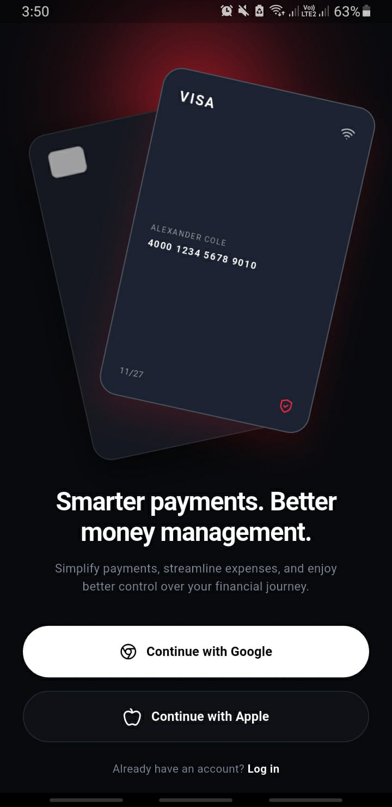
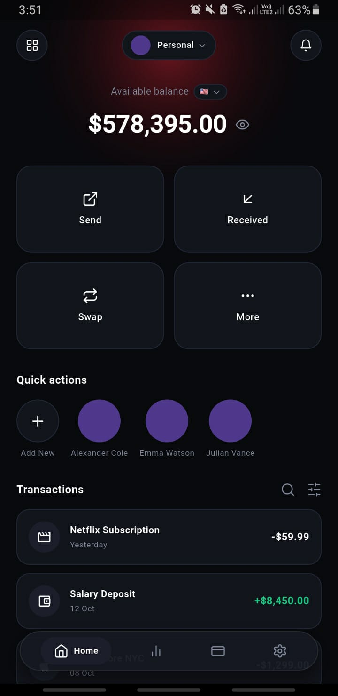
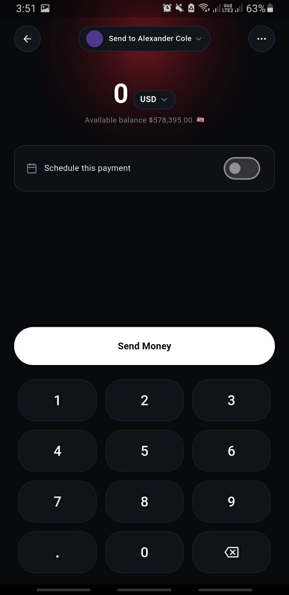

# ⚡ VoltPay — Luxury FinTech Digital Wallet & Card Architecture

> An enterprise-grade, luxury digital banking wallet and payment orchestration engine engineered in Flutter. Features atmospheric ambient lighting, 3D interactive gesture-driven Matrix4 cards, real local hardware biometrics, and a tactile custom dark numeric keypad.

---

### 📲 Direct Installation
Experience the production Android application directly on your device:  
🔗 **[Download Latest Release APK (v1.0.0)](https://github.com/musavir-ali-shah/voltpay-mobile-vault/releases)**

---

## 📸 Interface Preview

| Onboarding & 3D Cards | Banking Dashboard | Transfer & Custom Keypad |
|:---:|:---:|:---:|
|  |  |  |

---

## ⚡ Core Technical Highlights

- **3D Interactive Card Physics:** Custom Matrix4 perspective transformation combined with `GestureDetector` pan physics and idle harmonic floating animations simulating real credit card weight and tilt depth.
- **Hardware Biometric Authorization:** Deep platform integration with Android BiometricPrompt & Keystore (`local_auth`) verifying finger/face biometrics before authorizing state mutations.
- **Reactive Financial Ledger:** Built with Provider architecture, featuring real-time available balance deductions, currency string sanitization, and automated transaction history ledger insertion.
- **Custom Tactile Dark Keypad:** Custom numeric layout with tactile feedback, decimal point deduplication, and single/multi-digit deletion mechanisms.
- **Adaptive Screen Constraint Engine:** Zero-overflow architecture built using scalable scroll viewports and dynamic viewport constraints accommodating displays from small-factor devices to ultra-wide screens.

---

## 🛠️ Tech Stack & Dependencies

* **Framework:** Flutter (Android, iOS)
* **Language:** Dart 3.x
* **Hardware Security:** `local_auth` (Biometric Fingerprint & Face Authentication)
* **State Management:** `provider`
* **Icons:** `lucide_icons` & `cupertino_icons`
* **Typography:** `google_fonts` (Plus Jakarta Sans)

---

## 📁 Architectural Structure

    lib/
    ├── core/
    │   ├── constants/
    │   │   ├── app_colors.dart        # Luxury crimson & pitch black palette
    │   │   └── app_typography.dart    # Plus Jakarta Sans type scale
    │   ├── models/
    │   │   ├── transaction.dart       # Banking ledger data contracts
    │   │   └── contact.dart           # P2P recipient models
    │   └── providers/
    │       └── wallet_provider.dart   # Biometric verification & ledger state
    ├── views/
    │   ├── onboarding_view.dart       # Screen 1: 3D interactive Matrix4 cards
    │   ├── home_dashboard_view.dart   # Screen 2: Vault balance & quick actions
    │   ├── send_money_view.dart       # Screen 3: Custom keypad & transfer dispatch
    │   └── widgets/
    │       ├── luxury_bottom_nav.dart # Glassmorphic floating nav tray
    │       └── custom_keypad.dart     # Custom tactile dark numeric pad
    └── main.dart

---

## 🎨 Design & Attribution

- **Original UI/UX Concept:** Inspired by [Orbix Studio - FinTech Mobile App](https://dribbble.com/shots/27406354-Fintech-Payment-App-UI-Design) on Dribbble.
- Re-architected and engineered into production-ready Flutter code by **Syed Musavir Ali Shah**.

---

## 👨‍💻 Engineer & Contact

**Syed Musavir Ali Shah**  
*Flutter & Mobile Application Engineer*
- **Email:** musavir.ali717@gmail.com
- **LinkedIn:** https://www.linkedin.com/in/syed-musavir-ali-shah-156b2422b/
- **Location:** Karachi, Pakistan